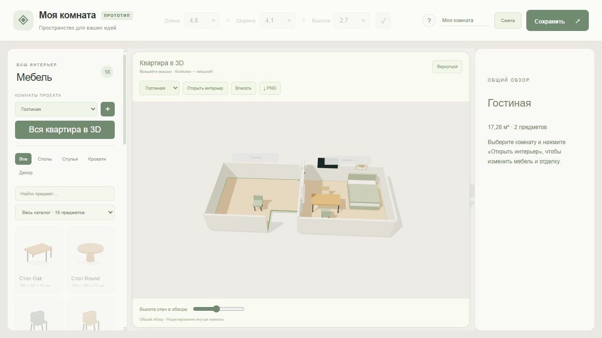
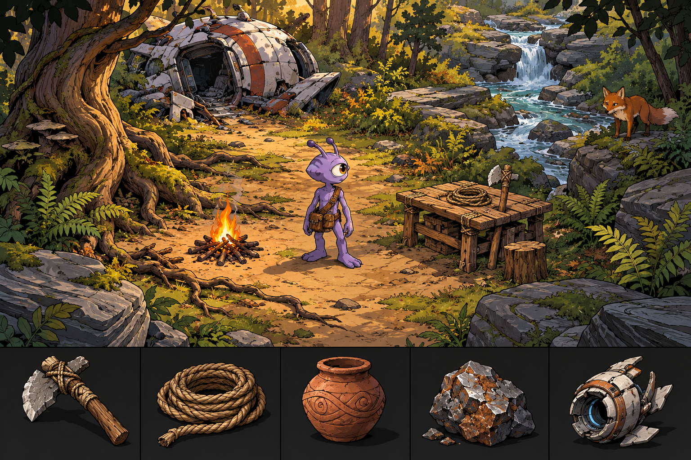
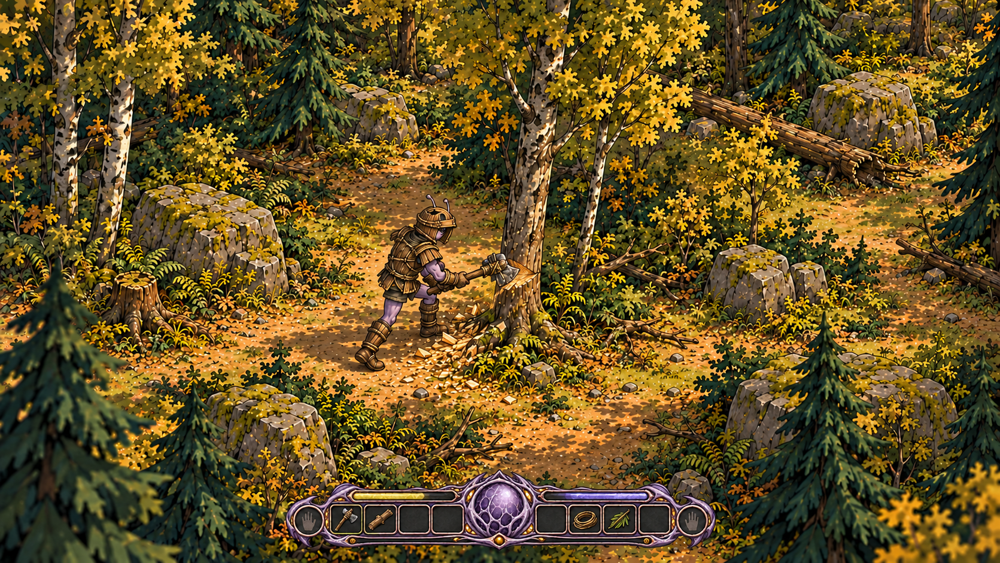
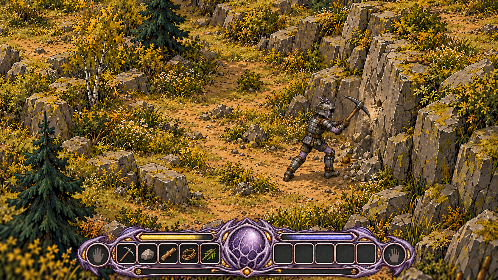
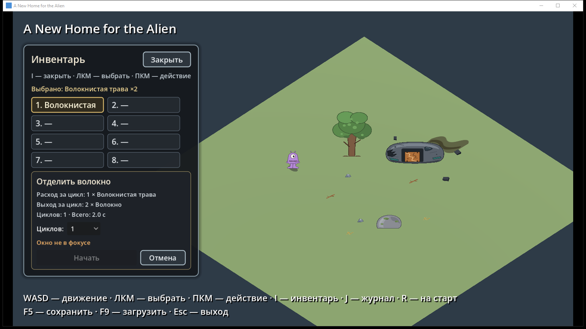

# Selected projects — Mykyta Drobushevskyi

I am building practical experience in automation, AI-assisted development and product iteration. These projects show how I turn an idea into requirements, divide work into tasks, review results and refine prototypes. Interfaces shown here are currently in Russian.

## Room Manager — browser-based 3D room planner

A local prototype for arranging furniture and retail equipment, editing room dimensions and viewing layouts in 3D. It supports multiple rooms, saving and JSON export. The image is an earlier prototype view, not a current catalogue count.

Built with JavaScript and Three.js; runs locally with Node.js and a WebGL-capable browser. In a local check on 2 November 2026, the server returned the page and 196 automated tests passed. The source repository is private, so this page does not provide a public download or live demo.

## Archipelago — turn-based strategy prototype

An offline Windows strategy game on a hex map, made with Unreal Engine. The project includes manual placement of settlements and roads, resources, computer opponents and a tutorial. It is a preview with incomplete localization and balancing; network features are not yet connected. The source and downloadable build are private, so they are not accessible through this page.

## Prishelets — A New Home for the Alien

A Godot survival-game prototype about an alien who crash-lands on Earth and learns to use local resources. The current work includes a test scene, movement, inspection, inventory and early hand crafting.

**Approved art direction:** the following concept illustration shows the visual style selected for the project. It is an artistic reference, not a screenshot of a playable build; the character and scene are illustrative.

**Gameplay visual concepts:** these illustrations explore the intended look of woodcutting and mining. They were generated as visual targets; they are not captures from a playable build and do not establish that the depicted interactions or interface are implemented.

**Early technical prototype:** the screenshot below is one of the early placeholder builds, kept to show the project's starting point. Its temporary artwork is not the selected visual direction.

[See an approved item-design selection](docs/prishelets.md#selected-item-design).

The game is in development, not released. The source and build are not included in this showcase. An automated hand-crafting check failed in the inspected local version, so this page does not claim the prototype is fully verified. See [the project note](docs/prishelets.md) for scope, future design and an example of the documentation process.

## My contribution and use of AI

I define requirements and priorities, break work into tasks, direct AI coding agents, review outputs, manually check results and request iterations. I also organize project knowledge and decisions in Obsidian. AI tools assisted with implementation and documentation; this is not a claim that I personally wrote all the code or built an autonomous professional agent platform. Automated checks and my manual review are separate activities.

